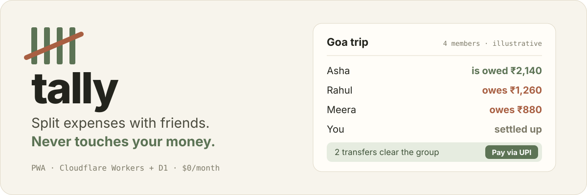
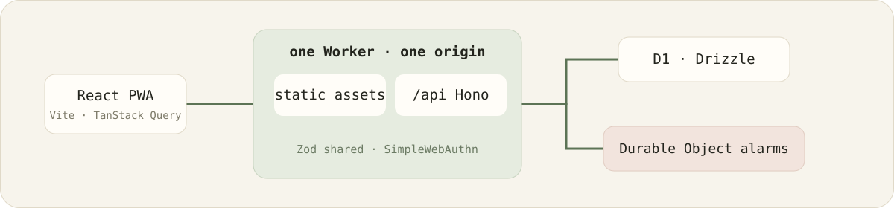

<h1 align="center">tally</h1>

<p align="center">
  
</p>

[](https://github.com/moneytosms/tally/actions/workflows/ci.yml)


Self-hosted expense splitting for friend groups. PWA.

One instance, ~20 people, $0/month on Cloudflare's free tier. Tracks who owes
what and hands you a UPI link to settle. **It never touches your money.**

---

## What it does

**Ledgers** - one container concept. A trip, a flatshare, and a one-to-one are
all Ledgers, differing only in whether they have an end date and a budget.

**Expenses** - split four ways: equally, by exact amounts, by shares, or by
percentage. Negative totals are refunds. Any member can edit any expense; every
edit is recorded and undoable.

**Balances** - a net position per person per ledger, plus a cross-ledger view
answering "what do I owe Rahul, overall?". Always derived, never stored. The
suggested transfers are the minimal set that clears a ledger, and every one of
them can explain itself.

**Settling** - declare a payment, optionally hand off to a UPI app. Partial
settles are first-class. Bulk settle clears someone across every shared ledger
at once.

Also: guests who never log in, recurring expenses, categories and notes, search
and filter, comments, lifetime analytics, CSV export, trip budgets with burn
rate, and push notifications for the two things worth interrupting someone about.

Sign in with an email and password or with a passkey - both work, on the same
account. Getting in still needs an invite from whoever runs the instance
(ADR 0006); there is no open door.

## What it deliberately does not do

Multi-currency · Splitwise import · receipt images · OCR · real payment
processing · trip kitty · payment rotation · read-only share links · in-app chat
· reliability scores · offline write sync · public signup.

## Stack

Cloudflare Workers + D1 + Drizzle + Hono · React SPA on Vite · TanStack Query ·
Zod shared client/server · Tailwind · SimpleWebAuthn · Durable Object Alarms.

<p align="center">
  
</p>

One Worker serves both the static assets and `/api/*`. One origin, no CORS.

## Getting started

```bash
pnpm install
pnpm test           # 300+ tests, real SQLite behind the D1 interface
pnpm dev            # vite + wrangler dev
```

To deploy your own instance, see **[docs/DEPLOYMENT.md](docs/DEPLOYMENT.md)**.
The provisioning wizard walks the whole thing:

```bash
./scripts/setup-cloudflare.sh
```

> ⚠️ One step in that wizard is **irreversible**. The Worker's name becomes the
> permanent WebAuthn RP ID; changing it later destroys every passkey on the
> instance with no migration path. See
> [ADR 0002](docs/adr/0002-rp-id-is-permanent.md).

## Documentation

|                                                  |                                                          |
| ------------------------------------------------ | -------------------------------------------------------- |
| **[CONTEXT.md](CONTEXT.md)**                     | Domain language. Use these terms; don't invent synonyms. |
| **[docs/ARCHITECTURE.md](docs/ARCHITECTURE.md)** | How it's built and why                                   |
| **[docs/DEPLOYMENT.md](docs/DEPLOYMENT.md)**     | First deploy, step by step, with the secret checklist    |
| **[docs/OPERATIONS.md](docs/OPERATIONS.md)**     | Running it: backups, limits, recovery                    |
| **[docs/SPEC.md](docs/SPEC.md)**                 | The buildable v1 spec                                    |
| **[docs/adr/](docs/adr/)**                       | Irreversible decisions and their reasoning               |
| **[docs/research/](docs/research/)**             | Hosting, UPI deep links, passkeys                        |

## The rules that aren't style choices

Violating any of these is a defect:

- **Money is integer paise.** No float in storage, API, or calculation. Ever.
- **Never render a bare amount.** Sign and label always - colour is never the
  only cue for owed vs owe.
- **The RP ID is a frozen constant.** Never derived from `location.hostname`.
- **Soft-delete filtering is structural**, in the data-access layer. Never left
  to callers.
- **Balances are derived**, never stored or cached.
- **Store resolved splits**, never recompute from weights.
- **Every user-facing string goes through `t()`.**
- **Never cache API responses in the service worker.** A stale balance is worse
  than no balance.
- **Guests are data, never principals.** No code path authenticates as a guest.

## Licence

Not currently licensed for redistribution - this is a single-instance personal
deployment, not a distributable product.
