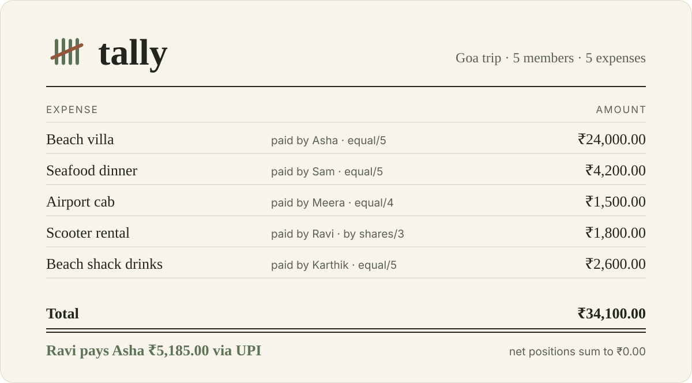
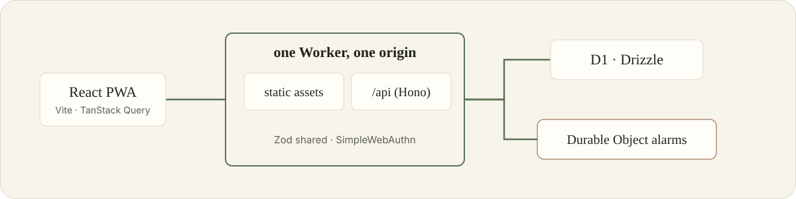

<h1 align="center">tally</h1>

<p align="center">
  <picture>
    <source media="(prefers-color-scheme: dark)" srcset="./assets/readme/hero-dark.svg">
    
  </picture>
</p>

<p align="center">
  <a href="https://moneytosms.github.io/tally/">Site</a> ·
  <a href="https://moneytosms.github.io/tally/guide/">Guide</a> ·
  <a href="docs/DEPLOYMENT.md">Self-host</a> ·
  <a href="docs/SPEC.md">Spec</a>
</p>

<p align="center">
  <a href="https://github.com/moneytosms/tally/actions/workflows/ci.yml"></a>
  <a href="LICENSE"></a>
</p>

Self-hosted expense splitting for friend groups, as a PWA. It tracks who owes
what, shows a small set of transfers that clear a ledger (at most one fewer than
the number of members; not guaranteed to be the fewest possible), and hands you a
UPI link to pay. **It never touches your money.**

The sheet above is real output: the Goa trip demo ledger, computed by the app.
Five expenses total ₹34,100.00. Asha paid most of it, so four people each pay
Asha once. Net positions sum to ₹0.00, always.

One instance, about 20 people, $0/month on Cloudflare's free tier.

## What it does

**Ledgers.** One container concept. A trip, a flatshare and a one-to-one are all
ledgers, differing only in whether they have an end date and a budget.

**Expenses.** Split equally, by exact amounts, by shares, or by percentage.
Negative totals are refunds. Any member can edit any expense; every edit is
recorded and undoable.

**Balances.** A net position per person per ledger, plus a cross-ledger view
that answers "what do I owe Ravi, overall?". Always derived, never stored. The
suggested transfers are a small set that clears a ledger (at most one fewer
than the number of members; not guaranteed to be the fewest possible), and each
one can explain itself.

**Settling.** Declare a payment, optionally hand off to a UPI app. Partial
settles are first-class. Bulk settle clears someone across every shared ledger
at once.

**Import.** Bring history in from a Splitwise CSV or a Splid XLS file.

Also: guests who never log in, recurring expenses, categories and notes, search
and filter, comments, lifetime analytics, CSV export, trip budgets with burn
rate, and push notifications for the two things worth interrupting someone
about. Push is built but not yet tested on a real device.

Sign in with email and password or a passkey; both work on the same account.
Joining needs an invite from whoever runs the instance (ADR 0006). There is no
open signup.

## How it works

<p align="center">
  <picture>
    <source media="(prefers-color-scheme: dark)" srcset="./assets/readme/architecture-dark.svg">
    
  </picture>
</p>

One Worker serves both the static assets and `/api/*`. One origin, no CORS.
Stack: Cloudflare Workers, D1, Drizzle, Hono, React on Vite, TanStack Query,
Zod shared by client and server, Tailwind, SimpleWebAuthn, Durable Object
Alarms. More in [docs/ARCHITECTURE.md](docs/ARCHITECTURE.md).

Rules that are defects when broken:

- **Money is integer paise.** No float in storage, API, or calculation.
- **Never render a bare amount.** Sign and label always; colour is never the
  only cue for owed vs owe.
- **The RP ID is a frozen constant.** Never derived from `location.hostname`.
- **Soft-delete filtering is structural**, in the data-access layer.
- **Balances are derived**, never stored or cached.
- **Store resolved splits**, never recompute from weights.
- **Every user-facing string goes through `t()`.**
- **Never cache API responses in the service worker.** A stale balance is worse
  than no balance.
- **Guests are data, never principals.** No code path authenticates as a guest.

## Getting started

```bash
pnpm install
pnpm test           # 500+ tests, real SQLite behind the D1 interface
pnpm dev            # vite + wrangler dev
```

Using the app: see the [usage guide](https://moneytosms.github.io/tally/guide/)
or [docs/USAGE.md](docs/USAGE.md).

## Self-hosting

MIT licensed, so forks are welcome. Follow
**[docs/DEPLOYMENT.md](docs/DEPLOYMENT.md)** for the first deploy and secret
checklist. The provisioning wizard walks the whole thing:

```bash
./scripts/setup-cloudflare.sh
```

> **Warning: one step is irreversible.** The Worker's name becomes the
> permanent WebAuthn RP ID. Changing it later destroys every passkey on the
> instance with no migration path. See
> [ADR 0002](docs/adr/0002-rp-id-is-permanent.md).

Running it afterwards (backups, limits, recovery): [docs/OPERATIONS.md](docs/OPERATIONS.md).

## Limits

Deliberately not built: multi-currency, receipt images, OCR, real payment
processing, trip kitty, payment rotation, read-only share links, in-app chat,
reliability scores, offline write sync, public signup.

Other docs: [CONTEXT.md](CONTEXT.md) (domain language),
[docs/SPEC.md](docs/SPEC.md) (v1 spec), [docs/adr/](docs/adr/) (irreversible
decisions), [docs/research/](docs/research/) (hosting, UPI deep links,
passkeys).

## Contributing

See [CONTRIBUTING.md](CONTRIBUTING.md). Use the terms in
[CONTEXT.md](CONTEXT.md), and check an ADR before contradicting it.

## License

MIT, see [LICENSE](LICENSE).
